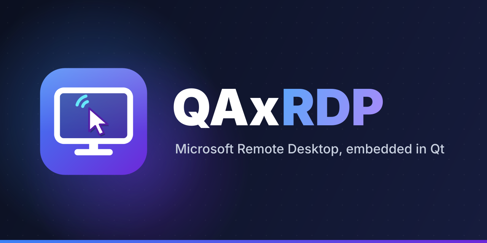
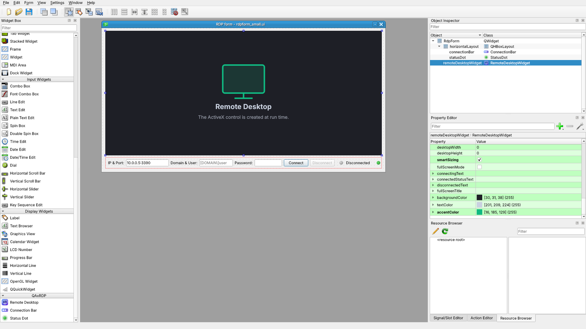

# QAxRDP

<p align="center"></p>

**QAxRDP** embeds the Microsoft Remote Desktop client (the `MsTscAx` ActiveX control used by `mstsc.exe`) in Qt
applications, with a pure Qt API: signals, slots and properties. It is written on top of
[ManyQt](https://pypi.org/project/ManyQt/), so the same code runs with **PyQt5, PyQt6, PySide2, PySide6** (and the
Qt4 bindings).

The goal is to let a Python/Qt application open RDP sessions inside its own windows, configure every option of the
Microsoft client (credentials, display, redirections, RD Gateway, RemoteApp...) and react to the session life cycle
with ordinary Qt signals, without touching COM.

> Version 2.0 is a complete rewrite of QAxRDP 1.x. See [Migrating from QAxRDP 1.x](#migrating-from-qaxrdp-1x).

## Contents:

| Category | Name | Package | Description |
|---|---|---|---|
| Remote desktop | `RemoteDesktopWidget` | `remotedesktop` | The RDP client control as a Qt widget. |
| Settings interfaces | `RdpControlSettings`, `RdpAdvancedSettings` (1 to 8), `RdpSecuredSettings` (1, 2), `RdpClientShell`, `RdpRemoteProgram` (1 to 3), `RdpTransportSettings` (1 to 4) | `remotedesktop` | The 19 setting groups of the control as QObjects (152 properties), reached from the widget (`rdp.advancedSettings`...). |
| Connection UI | `ConnectionBar` | `connectionbar` | Address / logon name / password fields, Connect / Disconnect buttons and status. |
| Connection UI | `StatusDot` | `connectionbar` | Painted status indicator that pulses while connecting. |
| Helpers | `parseAddress`, `parseUserName` | `connectionbar` | `'host:port'`, `'[ipv6]:port'` and `'DOMAIN\user'` parsers. |
| Helpers | `disconnectReasonText`, `isNormalDisconnect`, `isActiveXAvailable`, `controlProgId` | `remotedesktop` | Disconnect reasons, platform and control detection. |
| Application | `RemoteConnector`, `main()` | root | Ready-to-use RDP client window (`qaxrdp` command, `python -m QAxRDP`). |
| Qt Designer | `qaxrdpplugin.py`, `registerqaxrdp.py`, `launchDesigner()` | `designer` | Designer plugins for PyQt and PySide6, `qaxrdp-designer` launcher and plugin preview. |

Every package is self-contained (one folder to copy) and runnable: `python QAxRDP/remotedesktop/main.py`,
`python QAxRDP/connectionbar/main.py`.

## Key features:

- **Every ActiveX event is a typed Qt signal**: `connected`, `disconnected(int)`, `logonError(int)`,
  `loginComplete`, `fatalError(int)`, `autoReconnecting2(int, bool, int, int)`... and any signal can also be passed
  to the constructor as a callable: `RemoteDesktopWidget(connected=self.onConnected)`.
- **Every option is a Qt property**: a keyword argument, a getter, a `@pyqtSlot` setter and a `pyqtProperty`
  (`rdp.server`, `rdp.setServer()`, `rdp.setProperty('server', ...)`), so options can be bound to any Qt signal.
- **Complete settings coverage**: all the `IMsRdpClientAdvancedSettings*`, secured, transport (RD Gateway),
  RemoteApp and shell settings exposed by the control, documented in [`docs/API.md`](docs/API.md).
- **Validated and cached values**: ranges are clamped (ports, timeouts, color depths...); values can be set before
  connecting, survive a control version switch and stay readable when the control does not exist.
- **Safe with secrets**: passwords are written to the control but never returned by getters nor emitted by signals.
- **Graceful degradation**: without ActiveX (Linux, macOS, CI) the widget paints an explanatory placeholder and
  every API keeps working, so applications and tests run everywhere.
- **Control version fallback**: `MsTscAx.MsTscAx.11` by default, older registered versions are tried automatically.
- **One API for every binding** through ManyQt; the test suite passes on PyQt5 and PySide6.
- **Qt Designer plugins**: drag the widgets from a "QAxRDP" widget box section, edit their properties, and load
  the forms with `pyuic5`, `pyside6-uic` or `loadUi`.

## Requirements:

- Python 2.7 or 3.x.
- [ManyQt](https://pypi.org/project/ManyQt/).
- A Qt binding. **The remote desktop itself needs Windows** and a binding providing the `QAxContainer` /
  `QtAxContainer` module: PyQt5's Windows wheels include it; for another binding check that
  `from ManyQt.QAxContainer import QAxWidget` works.
- The Microsoft Remote Desktop client, present on every Windows desktop and server.

## Installation:

From PyPI:

```bash
pip install "QAxRDP[pyqt5]"    # with PyQt5 (recommended on Windows)
pip install "QAxRDP[pyside6]"  # or pyqt6 / pyside2 / pyside6 / designer
```

From a source checkout:

```bash
pip install .            # QAxRDP + ManyQt, using the Qt binding already installed
pip install .[pyqt5]     # with PyQt5 (recommended on Windows)
pip install .[pyside6]   # or pyqt6 / pyside2 / pyside6
pip install .[designer]  # adds PySide6, whose pyside6-designer loads the QAxRDP Designer plugins
```

ManyQt picks PyQt5 when several bindings are installed. To force one, set `QT_API` before any Qt import:

```bash
set QT_API=pyside6       # Windows (cmd); export QT_API=pyside6 elsewhere
```

## Quick start:

Run the bundled client:

```bash
qaxrdp                   # installed command
python -m QAxRDP         # same thing from a source tree
```

Embed the widget:

```python
from ManyQt.QtWidgets import QApplication, QMainWindow
from QAxRDP import RemoteDesktopWidget, isNormalDisconnect
from sys import argv, exit


class Window(QMainWindow):
    def __init__(self):
        super(Window, self).__init__()
        self.rdp = RemoteDesktopWidget(server='10.0.0.5', port=3389, domain='CONTOSO', userName='bob',
                                       password='********', smartSizing=True,
                                       settings={'redirectClipboard': True, 'enableCredSspSupport': True},
                                       connected=self.onConnected, disconnected=self.onDisconnected)
        self.setCentralWidget(self.rdp)
        self.rdp.connectToServer()

    def onConnected(self):
        self.statusBar().showMessage('Connected')

    def onDisconnected(self, reason):
        if not isNormalDisconnect(reason):
            self.statusBar().showMessage(self.rdp.getErrorDescription(reason))


app = QApplication(argv)
w = Window()
w.resize(1280, 800)
w.show()
exit(app.exec_())
```

## Usage:

### Connecting

```python
rdp.connectTo('server.contoso.com', 3390, userName='bob', password=pwd, domain='CONTOSO')
# or step by step
rdp.server = 'server.contoso.com'
rdp.setPort(3390)
rdp.connectToServer()          # returns False (and emits controlException) without control or server
rdp.disconnectFromServer()
rdp.isConnected()              # connectionState: 0 disconnected, 1 connected, 2 connecting
```

`connectionState` has a notify signal, `connectionStateChanged(int)`.

### Signals

| ActiveX event | Signal |
|---|---|
| `OnConnecting` / `OnConnected` / `OnLoginComplete` | `connecting()` / `connected()` / `loginComplete()` |
| `OnDisconnected` | `disconnected(int reason)` |
| `OnLogonError` / `OnFatalError` / `OnWarning` | `logonError(int)` / `fatalError(int)` / `warning(int)` |
| `OnAutoReconnecting` / `OnAutoReconnecting2` / `OnAutoReconnected` | `autoReconnecting(int, int)` / `autoReconnecting2(int, bool, int, int)` / `autoReconnected()` |
| `OnEnterFullScreenMode` / `OnLeaveFullScreenMode` | `enterFullScreenMode()` / `leaveFullScreenMode()` |
| `OnRequestGoFullScreen` / `OnRequestLeaveFullScreen` / `OnRequestContainerMinimize` | `requestGoFullScreen()` / `requestLeaveFullScreen()` / `requestContainerMinimize()` |
| `OnConfirmClose` / `OnIdleTimeoutNotification` | `confirmClose()` / `idleTimeoutNotification()` |
| `OnChannelReceivedData` | `channelReceivedData(str channel, str data)` |
| `OnReceivedTSPublicKey` / `OnUserNameAcquired` / `OnServiceMessageReceived` | `receivedTSPublicKey(str)` / `userNameAcquired(str)` / `serviceMessageReceived(str)` |
| `OnRemoteDesktopSizeChange` / `OnNetworkStatusChanged` | `remoteDesktopSizeChange(int, int)` / `networkStatusChanged(int, int, int)` |
| `OnMouseInputModeChanged` / `OnFocusReleased` | `mouseInputModeChanged(bool)` / `focusReleased(int)` |
| `OnRemoteProgramDisplayed` / `OnRemoteProgramResult` / `OnRemoteWindowDisplayed` | `remoteProgramDisplayed(bool, int)` / `remoteProgramResult(str, int, bool)` / `remoteWindowDisplayed(bool, object, int)` |
| `OnAuthenticationWarningDisplayed` / `OnAuthenticationWarningDismissed` | `authenticationWarningDisplayed()` / `authenticationWarningDismissed()` |
| `OnConnectionBarPullDown` / `OnDevicesButtonPressed` | `connectionBarPullDown()` / `devicesButtonPressed()` |
| `exception` / `propertyChanged` (QAxBase) | `controlException(int, str, str, str)` / `controlPropertyChanged(str)` |

The widget also emits `controlChanged(str progId)` and `connectionStateChanged(int)`. If the binding cannot forward
an event, it is listed by `rdp.getUnconnectedEvents()`.

### Settings

The most common options are properties of the widget: `server`, `port`, `domain`, `userName`, `password`
(write-only), `colorDepth`, `desktopWidth`, `desktopHeight`, `smartSizing`, `fullScreenMode`, `connectingText`,
`connectedStatusText`, `disconnectedText`, `fullScreenTitle`, and read-only `version`, `cipherStrength`,
`connectionState`, `extendedDisconnectReason`, `securedSettingsEnabled`.

Everything else lives in the settings interfaces, with the same three access styles:

```python
rdp.advancedSettings.setRedirectDrives(True)               # setter (a slot)
rdp.advancedSettings2.maxReconnectAttempts = 5             # property
rdp.securedSettings.setProperty('startProgram', 'notepad.exe')
slider.valueChanged.connect(rdp.advancedSettings.setMinutesToIdleTimeout)
```

Or many at once with `applySettings()`, which accepts python names, ActiveX names and `interface.property` keys,
case-insensitively, and returns the keys it could not apply:

```python
rejected = rdp.applySettings({
    'colorDepth': 24,
    'RedirectClipboard': True,                        # ActiveX name
    'advancedSettings.rdpPort': 3390,
    'TransportSettings.GatewayHostname': 'gw.contoso.com',
})
```

The full list (types, access, ranges, ActiveX names) is in [`docs/API.md`](docs/API.md). Enumerations are nested in
the classes, e.g. `RdpAdvancedSettings4.AuthenticationWarn`, `RdpSecuredSettings.ApplyRemotely`,
`RdpTransportSettings.Direct`.

### RD Gateway

```python
ts = rdp.transportSettings
ts.setGatewayHostname('gw.contoso.com')
ts.setGatewayUsageMethod(ts.Direct)
ts.setGatewayCredsSource(ts.UserPassword)
rdp.transportSettings2.setGatewayUsername('bob')
rdp.transportSettings2.setGatewayPassword(pwd)
```

### RemoteApp

```python
rdp.remoteProgram.setRemoteProgramMode(True)
rdp.connected.connect(lambda: rdp.remoteProgram.serverStartProgram('||calc', '', '%SYSTEMDRIVE%', True, '', False))
rdp.connectToServer()
```

### Virtual channels

```python
rdp.createVirtualChannels(['MYCHAN'])      # before connecting
rdp.channelReceivedData.connect(lambda channel, data: print(channel, data))
rdp.sendOnVirtualChannel('MYCHAN', 'hello')
```

### Errors, screenshots, display

```python
rdp.getErrorDescription(reason)            # text from the control, built-in table as fallback
rdp.saveScreenshot('session.png')          # grabs the native window, ActiveX content included
rdp.updateSessionDisplaySettings(1920, 1080)
rdp.setControlVersion(10)                  # recreates the control, settings are reapplied
rdp.getAxWidget()                          # the underlying QAxWidget for direct QAxBase calls
rdp.releaseControl()                       # release the control now (automatic when the application quits)
```

## Qt Designer:

<p align="center"></p>

`RemoteDesktopWidget`, `ConnectionBar` and `StatusDot` appear in a **QAxRDP** section of Designer's widget box.
Start Designer with the plugins registered:

```bash
qaxrdp-designer                      # finds a Qt Designer for your binding and opens it
qaxrdp-designer --api pyside6 form.ui
qaxrdp-designer --preview            # what each plugin gives Designer, without Designer
qaxrdp-designer --print-env          # the variables to set to use another Designer / Qt Creator
```

| Binding | Plugin file | Registered through | Designer used by `qaxrdp-designer` |
|---|---|---|---|
| PySide6 | `QAxRDP/designer/registerqaxrdp.py` | `PYSIDE_DESIGNER_PLUGINS` | `pyside6-designer` (installed with PySide6) |
| PyQt5 / PyQt6 / PyQt4 | `QAxRDP/designer/qaxrdpplugin.py` | `PYQTDESIGNERPATH` | `pyqt5-tools designer`, `pyqt6-tools designer` or a `designer` on PATH; it must have PyQt's Designer plugin loader |

PySide2's Designer cannot load Python plugins. The plugin directory works from an installed package or straight
from a source checkout.

Forms reference the widgets with the header `QAxRDP`, so generated code imports them from the package:

```bash
pyuic5 form.ui -o ui_form.py           # -> from QAxRDP import ConnectionBar, RemoteDesktopWidget, StatusDot
pyside6-uic form.ui -o ui_form.py
```

```python
from PyQt5 import uic
form = uic.loadUi('form.ui')          # PyQt
form.remoteDesktopWidget.setPassword(password)
form.remoteDesktopWidget.connectToServer()
```

With PySide6's `QUiLoader`, register the classes first: `loader.registerCustomWidget(RemoteDesktopWidget)`.

In Designer the RDP control is not started (`autoCreateControl` is off there): the widget shows a placeholder, and
the real control is created when the form runs. Only meaningful options are editable (server, port, domain,
userName, colorDepth, desktop size, smartSizing, texts, colours, control version). The password, the advanced
settings objects and the runtime state are hidden so that they never end up in `.ui` files: set them in code.

## Migrating from QAxRDP 1.x:

| QAxRDP 1.x | QAxRDP 2.x |
|---|---|
| `from QAxRDP import QAxRemoteDesktop` | `from QAxRDP import RemoteDesktopWidget` |
| `from PyQt5...` | `from ManyQt...` |
| `rdp.Server('host')` / `rdp.Server()` | `rdp.setServer('host')` / `rdp.getServer()` / `rdp.server` |
| `rdp.UserName(u)`, `rdp.Domain(d)`, `rdp.DesktopWidth(w)`... | `setUserName(u)`, `setDomain(d)`, `setDesktopWidth(w)`... |
| `rdp.AdvancedSettings.RDPPort(3390)` | `rdp.setPort(3390)` or `rdp.advancedSettings.setRdpPort(3390)` |
| `rdp.AdvancedSettings.ClearTextPassword(p)` | `rdp.setPassword(p)` |
| `rdp.AdvancedSettings.SmartSizing(True)` | `rdp.setSmartSizing(True)` |
| `rdp.AdvancedSettings5.RedirectClipboard(True)` | `rdp.advancedSettings5.setRedirectClipboard(True)` |
| `rdp.MsRdpClientShell.RdpFileContents(s)` | `rdp.clientShell.setRdpFileContents(s)` |
| `rdp.Connect()` / `rdp.Disconnect()` | `rdp.connectToServer()` / `rdp.disconnectFromServer()` |
| `rdp.Connected()` | `rdp.isConnected()` / `rdp.connectionState` |
| `rdp.onConnected = fn` + `rdp.connectAllSignals()` | `rdp.connected.connect(fn)` or `RemoteDesktopWidget(connected=fn)` |
| overriding `onDisconnected(self, reason)` | `disconnected(int)` signal |
| `Exception(...)` / `PropertyChanged(name)` | `controlException(...)` / `controlPropertyChanged(str)` signals |
| `rdp.parseArguments({...})` | `rdp.applySettings({...})` |
| `rdp.version(8)` | `rdp.setControlVersion(8)` or `RemoteDesktopWidget(controlVersion=8)` |
| `rdp.Screenshot()` / `rdp.SaveScreenshot(path)` | `rdp.grabScreenshot()` / `rdp.saveScreenshot(path)` |
| `CreateVirtualChannels(s)` / `SendOnVirtualChannel(c, d)` | `createVirtualChannels(names)` / `sendOnVirtualChannel(c, d)` |
| `AttachInterfaces()`, `CreateSink()`, `DetachSink()` | removed: .NET `AxHost` methods, not part of the control |
| `RemoteConnector` in `main.py` | `RemoteConnector` in `mainwindow.py`, run with `qaxrdp` |

Names follow Qt conventions: `getX()` / `isX()` getters, `setX()` setters, camelCase properties whose names come
from the ActiveX names (`RDPPort` -> `rdpPort`, `PCB` -> `pcb`, `KeyBoardLayoutStr` -> `keyBoardLayoutStr`). See
[`CHANGELOG.md`](CHANGELOG.md) for the bugs fixed by the rewrite.

## Project layout:

```
QAxRDP/
├── setup.py, pyproject.toml, requirements.txt, MANIFEST.in
├── .github/
│   ├── workflows/release.yml # tests, build, PyPI and GitHub release v<version>
│   ├── scripts/release.py    # release checks used by the workflow (version, notes, distributions)
│   └── FUNDING.yml
├── README.md, CHANGELOG.md, LICENSE
├── QAxRDP/
│   ├── __init__.py          # exports every public name
│   ├── __main__.py          # python -m QAxRDP
│   ├── main.py              # main(): the qaxrdp command
│   ├── mainwindow.py        # RemoteConnector, createAppIcon()
│   ├── version.py           # __version__ (read by setup.py)
│   ├── images/logo.png      # application icon
│   ├── remotedesktop/
│   │   ├── remotedesktop.py # RemoteDesktopWidget, events table, helpers
│   │   ├── rdpsettings.py   # settings interfaces (generated by tools/rdpsettings)
│   │   ├── mainwindow.py    # demo: server field, event log
│   │   └── main.py
│   ├── connectionbar/
│   │   ├── connectionbar.py # ConnectionBar, StatusDot, parseAddress, parseUserName
│   │   ├── mainwindow.py    # demo: simulated connection
│   │   └── main.py
│   └── designer/
│       ├── qaxrdpplugin.py  # Designer plugin for PyQt
│       ├── registerqaxrdp.py# Designer plugin for PySide6
│       ├── widgetinfo.py    # widget descriptions shared by both plugins
│       ├── designer.py      # launcher and environment helpers (no Qt import)
│       ├── mainwindow.py    # plugin preview
│       ├── main.py          # qaxrdp-designer
│       └── images/          # widget box icons
├── docs/
│   ├── images/              # logo, banner (PNG + SVG), Designer screenshot
│   ├── API.md               # settings reference (generated)
│   ├── MsTscAx-control-reference.html  # QAxWidget.generateDocumentation() of MsTscAx.MsTscAx.11
│   └── links.md             # Microsoft documentation and related projects
├── tests/                   # python -m unittest discover -s tests -v
└── tools/
    ├── rdpsettings/         # generator of rdpsettings.py and docs/API.md (spec.py = property tables)
    └── branding/            # generator of the logo, banner and icons
```

## Development:

```bash
python -m unittest discover -s tests -v       # ActiveX tests run on Windows only, the others everywhere
python tools/rdpsettings/generate.py          # after editing tools/rdpsettings/spec.py
python tools/branding/makebranding.py         # after changing the logo or banner drawing
QT_API=pyside6 python -m unittest discover -s tests   # same suite on another binding
```

`rdpsettings.py` and `docs/API.md` are generated: change `tools/rdpsettings/spec.py` (properties, types, ranges,
descriptions) or `header.py.tpl`, then regenerate instead of editing them by hand.

## Releasing:

Releases are made by `.github/workflows/release.yml`. It runs when `QAxRDP/version.py` changes on `main` / `master`,
or by hand: **Actions > Release > Run workflow** (or `gh workflow run release.yml`).

1. Set `__version__` in `QAxRDP/version.py` and add a `## <version> - <date>` section to `CHANGELOG.md`: it becomes
   the release notes, and the workflow refuses to release without it.
2. Push. The workflow checks the version and the changelog, runs the tests (PyQt5 on Python 3.10, 3.12 and 3.13,
   PySide6 on 3.12, and Windows with the real ActiveX control), builds the sdist and the wheel, checks
   them with `twine check --strict` and installs the wheel in a clean environment.
3. Only then it publishes on PyPI and creates the GitHub release **v<version>** with the distributions attached. The
   release and its tag are forced: an existing `v<version>` is deleted and recreated on the current commit.

PyPI never accepts the same version twice: if it is already published, the PyPI step is skipped with a warning (the
GitHub release is still made). Bump the version to publish again.

One-time setup of the PyPI authentication, either:

- **Trusted publishing** (recommended, no secret): on PyPI, *Your account > Publishing > Add a new pending
  publisher* (or the project's *Publishing* page once it exists) with PyPI project `QAxRDP`, your GitHub owner and
  repository, workflow `release.yml` and environment `pypi`.
- **API token**: create a token on PyPI and save it as the repository secret `PYPI_API_TOKEN`.

The package description on PyPI is this README; when built by the workflow, its relative links and images are made
absolute (pinned to the released commit), so the repository must be public for the images to show there.

## Notes and limitations:

- The control only exists on Windows. Elsewhere `isActiveXAvailable()` is `False`, `controlAvailable` is `False`,
  `errorString` explains why and connecting emits `controlException`.
- Event forwarding uses the dynamic signals that the binding creates for the control. PyQt5 supports them; with
  other bindings, check `getUnconnectedEvents()`.
- Write-only ActiveX properties (`ClearTextPassword`, `FullScreenTitle`, `RemoteApplicationName`...) cannot be read
  back from the control: their getters return the last value set through QAxRDP (passwords return `''`).
- Some properties are documented by Microsoft as unsupported by recent clients; they are kept for completeness and
  marked as such in `docs/API.md`.
- Settings are sent to the control when set. Most of them only take effect at the next connection.

## Logo and banner:

The logo (`docs/images/logo.svg`, `.png`) and the banner (`docs/images/banner.svg`, `.png`, 1280x640, the size of
GitHub's social preview) are drawn by `tools/branding/makebranding.py`, which also writes the application icon and
the Designer icons. The SVG files contain no text elements (texts are outlines), so they render the same everywhere.

## License:

GPLv3, see [LICENSE](LICENSE). Copyright 2022-2026 Aininou Usama (ininou.oussematn@gmail.com).

## References:

See [`docs/links.md`](docs/links.md): Microsoft Remote Desktop Services documentation, `rdpappcontainerclient.h`,
Devolutions MsRdpEx and ManyQt.
